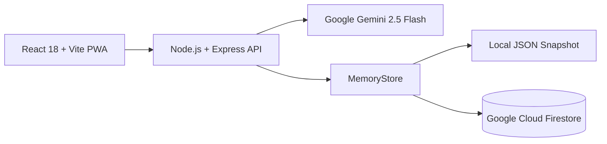

# AstraMinds — Youth Financial Literacy & Digital Safety Platform

<p align="center">
  
</p>

<p align="center">
  <b>Pocket-money budgeting, interactive daily challenges & digital money safety superpowers built specifically for students aged 8–14.</b><br>
  An experiential financial education platform merging autonomous savings jars, scam-spotting drills, AI-powered daily budget challenges, and parent-approved real-world reward vouchers.
</p>

<p align="center">
  
  
  
  
  
  
  
  
  
  
</p>

---

## 📖 Table of Contents

1. [Overview & Core Philosophy](#-overview--core-philosophy)
2. [Key Feature Modules](#-key-feature-modules)
3. [Architecture & Technical Design](#-architecture--technical-design)
4. [Project Documentation Links](#-project-documentation-links)
5. [Local Development Setup](#-local-development-setup)
6. [Cloud Run & Firebase Deployment](#-cloud-run--firebase-deployment)
7. [Zero-Risk Kid-Safety Sandbox](#-zero-risk-kid-safety-sandbox)
8. [License & Attribution](#-license--attribution)

---

## 🌟 Overview & Core Philosophy

Traditional financial apps act like static spreadsheets — they track money after it is already spent and assume adult banking knowledge. **AstraMinds** transforms youth financial education into an active, gamified daily habit tailored for young minds (ages 8–14):

* **100% Risk-Free Virtual Sandbox:** No real bank accounts, credit cards, or real money transfers. Students build habits safely using virtual currency.
* **Autonomous Goal Auto-Save:** Virtual pocket money is automatically allocated into dream goal jars on a schedule.
* **AI-Powered Daily Budget Dilemmas:** Personalized scenarios created with Google Gemini teach trade-offs between essential Needs and impulse Wants.
* **Digital Cyber Defense Drills:** Interactive visual scam simulations teach students to spot phishing links, protect secret OTPs, and never share parental banking data.
* **Tangible Parent Bridge:** Virtual Gold Coins earned through learning can be redeemed for parent-signed real-world privileges (gaming time, ice cream outings, chore passes).

---

## 🚀 Key Feature Modules

### 🎯 1. Onboarding & Age-Tier Calibration (Ages 8–14)
* **Age & Grade Gate:** Strictly limits onboarding between ages 8 and 14 (Grades 3–9).
* **Calibrated Learning Tiers:**
  * **Junior Savers (Ages 8–10):** Concrete visual stories, saving jars, and needs vs. wants basics.
  * **Smart Budgeters (Ages 11–13):** Pocket money tracking, allowance planning, and phishing scam spotting.
  * **Financial Explorers (Age 14):** Compound growth math, digital banking primitives, and cyber defense.

### 🛡️ 2. "Today's Mission" & Guided Starter Checklist
* **Hero Mission Banner:** Prominently displays the student's primary daily challenge (*"Complete the 2-min Scam Spotter Quiz for +50 Coins"*).
* **3-Step First-Day Mission Checklist:** Eliminates blank-canvas hesitation for new students:
  1. *Set your first dream savings goal 🎯*
  2. *Take today's 2-minute safety challenge 🛡️*
  3. *Log your first pocket money or chore reward 💰*

### 🪙 3. Pocket Money Tracker & Cash Flow Management
* **Kid-Friendly Categories:** Snacks & Treats, Books & Comics, Games & Apps, Chore Rewards, and Gift Money.
* **Auto-Allowance Scheduler:** Parents and students can configure recurring weekly (e.g. ₹200 every Sunday) or monthly pocket money deposits.
* **Needs vs. Wants Donut Chart:** Visualizes monthly spending split with actionable smart-habit coaching.
* **Category Budget Caps:** Set spending caps with friendly warning badges.

### 🚲 4. Savings Goals & Visual Goal Jars
* **Custom Photos & Curated Icons:** Pick from 16 kid-friendly emojis or upload a photo of the real item being saved for.
* **Future Delay Impact Calculator:** Shows how a ₹400 impulse toy purchase delays a ₹4,500 bicycle goal by 12 days.
* **Goal Milestone Celebration:** 100% target celebration, unlockable **"Goal Crusher 🏆"** profile badge, and downloadable PDF Achievement Certificate.

### ⚡ 5. Daily AI Budget Challenges & Decision Journal
* **Dynamic Scenarios:** Generates daily dilemmas with surprise emergency expenses (e.g. flat bike tire, forgotten project supplies).
* **AI Decision Coaching:** Evaluates student reasoning and provides contextual feedback.
* **Past Scenarios Decision Journal:** Archives previous challenges, savings achieved, and AI advice tips.

### 🕵️ 6. Weekly Quizzes & Visual Scam Red-Flag Challenges
* **Dual-Track Quizzes:** *Money Smarts* and *Digital Money Safety*.
* **Interactive Visual Scam Spotter:** Smartphone notification simulation where students tap 3 red flags (*Urgency Pressure*, *Secret OTP Demand*, *Suspicious Shortlink*).

### 🎟️ 7. Coin Economy & Parent Reward Vouchers
* **Parent-Approved Privileges:** Redeem Gold Coins for real-world rewards:
  * 🎮 *1 Extra Hour of Weekend Gaming*
  * 🍦 *Ice Cream Parlor Outing with Parents*
  * 🎬 *Friday Family Movie & Popcorn Pick*
  * 🧹 *One Night Chore Pass*
  * 📚 *Bookstore / Comic Pick of Choice*
* Generates a digital pass with unique code and parent verification signature box.

### 📱 8. Progressive Web App (PWA)
* Fully installable on iPads, Android tablets, Chromebooks, and smartphones via Web App Manifest and Service Worker caching.

---

## 🏛️ Architecture & Technical Design



* **Frontend:** React 18, Vite 6, TypeScript, Tailwind CSS 4, Framer Motion, GSAP, Recharts, Lucide Icons.
* **Backend:** Node.js 20+, Express 5, JWT Authentication, bcryptjs, Multer.
* **Agentic AI:** Google Gemini 2.5 Flash via `@google/genai` and `@langchain/google-genai`.
* **Dual Persistence:**
  * **Local Dev:** Automated atomic JSON snapshotting (`data/astraminds_store.json`) with zero external database dependencies.
  * **Cloud Run:** Automated cloud persistence via **Google Cloud Firestore** using Google Cloud Application Default Credentials (ADC).

---

## 📚 Project Documentation Links

Deep-dive architecture specifications and process diagrams are maintained in the [`docs/`](docs/) directory:

* 📊 **[Process Flow Diagrams](docs/PROCESS_FLOW_DIAGRAM.md):** End-to-end Mermaid flows for onboarding, daily budget loops, goal auto-save, and voucher redemption.
* 🏛️ **[System Architecture](docs/SYSTEM_ARCHITECTURE.md):** Technical design, component boundaries, hybrid persistence model, and kid-safety architecture.
* 🛠️ **[Technologies Used](docs/TECHNOLOGIES_USED.md):** Comprehensive inventory of frameworks, libraries, versions, and architectural rationales.
* 🔮 **[Future Scope & Roadmap](docs/FUTURE_SCOPE.md):** Strategic evolution covering parent companion views, simulated teen UPI, multilingual localizations, and NEP 2020 alignment.
* 📋 **[Available Features Catalog](docs/AVAILABLE_FEATURES.md):** Complete exhaustive inventory of every currently active feature in the MVP.

---

## 💻 Local Development Setup

### Prerequisites
* Node.js `>=20.x`
* npm `>=10.x`

### Installation & Run

1. **Clone the repository:**
   ```bash
   git clone https://github.com/ojasdighe/AstraMinds_MVP.git
   cd AstraMinds_MVP
   ```

2. **Install dependencies:**
   ```bash
   npm install
   ```

3. **Configure Environment Variables:**
   Create a `.env` file in the project root (see `.env.example`):
   ```env
   PORT=3000
   JWT_SECRET=your-secure-random-secret-key-min-32-chars
   GEMINI_API_KEY=your-gemini-api-key-here
   ```

4. **Start Development Server:**
   ```bash
   npm run dev
   ```
   * The app will start on `http://localhost:3000` (or the next available port).
   * Local changes are automatically saved to `data/astraminds_store.json` so you never lose testing progress across restarts.

5. **Build for Production:**
   ```bash
   npm run build
   ```

---

## ☁️ Cloud Run & Firebase Deployment

AstraMinds is containerized and configured for automated deployments to **Google Cloud Run**:

### Automated GitHub CI/CD via Cloud Build
1. In **Google Cloud Console**, go to **Cloud Run** > **Create Service**.
2. Select **"Continuously deploy from a repository"** and connect your GitHub repo `ojasdighe/AstraMinds_MVP`.
3. Set build type to **Dockerfile** (uses [`Dockerfile`](Dockerfile) and [`cloudbuild.yaml`](cloudbuild.yaml)).
4. Under Environment Variables, add:
   * `NODE_ENV` = `production`
   * `FIRESTORE_ENABLED` = `true`
   * `JWT_SECRET` = `(your random secret)`
   * `GEMINI_API_KEY` = `(your gemini key)`
5. Ensure the Cloud Run Service Account has the **Cloud Datastore User** role to connect with Firebase Firestore.
6. Every push to `main` automatically triggers an atomic rolling build and deployment with zero downtime!

---

## 🛡️ Zero-Risk Kid-Safety Sandbox

AstraMinds is built from the ground up to protect children's online safety and privacy:
* **No Real Banking Credentials:** Zero bank account numbers, UPI IDs, credit cards, or financial credentials are ever requested or stored.
* **No Third-Party Advertising:** Zero ad trackers, tracking cookies, or third-party marketing SDKs.
* **Minimal Data Footprint:** Accounts require only a first name/preferred nickname and email address.
* **Tenant Isolation:** All data access is strictly bounded by cryptographically verified JWT tokens.

---

## 📄 License & Attribution

© 2026 AstraMinds — An Asterra Solutions Initiative. All rights reserved.  
Made with ❤️ for young savers aged 8–14.
