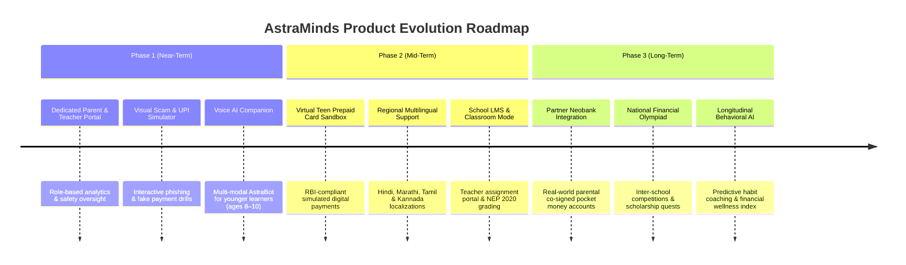

# AstraMinds — Future Scope & Strategic Roadmap

This document outlines the strategic product vision, architectural evolution, and phased feature roadmap for AstraMinds as it expands from an MVP into an institutional youth financial literacy and digital safety ecosystem.

---

## 1. Strategic Roadmap Overview

---

## 2. Phase 1: Near-Term Enhancements (Next 3–6 Months)

### 2.1 Dedicated Parent & Teacher Oversight Portal
* **Parent Companion View:** A separate authenticated view where parents can review their child's:
  * Weekly budget discipline score and Needs vs. Wants balance.
  * Digital safety quiz scores and scam spotter mastery.
  * Auto-allowance approval and digital voucher signing (with one-click approvals sent via WhatsApp or email digests).
* **Teacher Classroom View:** Enables educators to set weekly classroom money challenges, track student cohort progress, and export grade-level financial literacy certificates aligned with CBSE and state board guidelines.

### 2.2 Advanced Interactive Visual Scam & UPI Simulator
* **Interactive UPI Payment Screen Simulator:** Simulated fake payment apps where students learn to spot:
  * **QR Code Traps:** Teaching kids that scanning a QR code is *only* for sending money, never for receiving money.
  * **Fake Payment Screenshots:** Training students to spot counterfeit UPI transaction receipts used by marketplace scammers.
  * **Social Engineering Traps:** Simulated chat bots posing as gaming moderators requesting credentials.

### 2.3 Voice-Interactive AI Mascot Companion
* **Multimodal Voice Agent:** For younger students (ages 8–10) who prefer listening and speaking over reading dense text:
  * Low-latency text-to-speech (TTS) and speech-to-text (STT) powered by Google Gemini Live API.
  * AstraBot can verbally read questions, celebrate milestone achievements, and explain financial concepts using warm, encouraging conversational audio.

---

## 3. Phase 2: Medium-Term Expansion (6–12 Months)

### 3.1 Simulated Teen Prepaid Card & UPI Sandbox
* **Virtual Card Simulator:** An interactive in-app debit card interface that simulates modern banking primitives:
  * Dynamic CVV masking and card lock/unlock controls.
  * Simulated POS tap-and-pay and online transaction approvals requiring simulated 2-factor OTP authorization.
  * Strict adherence to zero-real-money policies to maintain a risk-free learning environment while preparing students for modern digital economies.

### 3.2 Regional Multilingual Localization
To support tier-2 and tier-3 cities and regional board schools across India, expand the UI and AI curriculum generation to:
* **Hindi**, **Marathi**, **Tamil**, **Telugu**, **Kannada**, and **Bengali**.
* Contextualizes curriculum examples to local regional market scenarios, school canteens, festivals, and vernacular idioms.

### 3.3 Collaborative Group Savings & Classroom Quests
* **Group Savings Pools:** Students collaborate in simulated classrooms or sibling teams to fund collective goals (e.g. funding a simulated classroom science trip or community library fund).
* Teaches cooperative budgeting, consensus decision-making, and financial accountability.

---

## 4. Phase 3: Long-Term Horizon (12–24 Months)

### 4.1 Partner Neo-Bank / Real Banking Bridge (Parental Co-Signing)
* As students graduate from the virtual sandbox (approaching age 14+), provide an optional, opt-in bridge to RBI-licensed partner banks or juvenile pre-paid card providers.
* Full parental co-signing, strict merchant category blocking (disallowing adult entertainment, gaming microtransactions, and gambling), and real-time transaction alerts.

### 4.2 National Youth Financial Literacy Olympiad
* Annual national digital tournament connecting participating schools and communities.
* Timed cyber defense simulations, algorithmic budgeting challenges, and merit-based recognition.
* Sponsored educational scholarships and badges endorsed by financial institutions and consumer protection boards.

### 4.3 Longitudinal Behavioral Analytics & Academic Efficacy Studies
* Partner with education researchers and developmental psychologists to study the long-term impact of early gamified financial education on delayed gratification and impulse spending.
* Anonymized, aggregated habit trends published as an annual **Youth Financial Resilience Report**.

---

## 5. Regulatory Compliance & Governance Architecture

As AstraMinds scales, the platform architecture will maintain strict alignment with Indian and international youth privacy standards:

| Regulatory Framework | Compliance Strategy & Implementation |
| :--- | :--- |
| **Digital Personal Data Protection Act (DPDPA 2023 - India)** | Verifiable parental consent (VPC) mechanisms for minors under 18; no tracking, profiling, or targeted advertisements directed at children. |
| **National Education Policy (NEP 2020)** | Direct alignment with experiential, vocational, and digital literacy mandates for middle and secondary school grades. |
| **COPPA / GDPR-K Alignment** | Absolute data minimization; right-to-be-forgotten / one-click account and data erasure APIs; zero third-party tracking scripts. |
| **Responsible AI Principles** | Deterministic safety filters on Gemini prompt outputs ensuring child-appropriate language, culturally sensitive financial examples, and zero encouragement of high-risk speculative trading (e.g. crypto or stock day-trading). |
