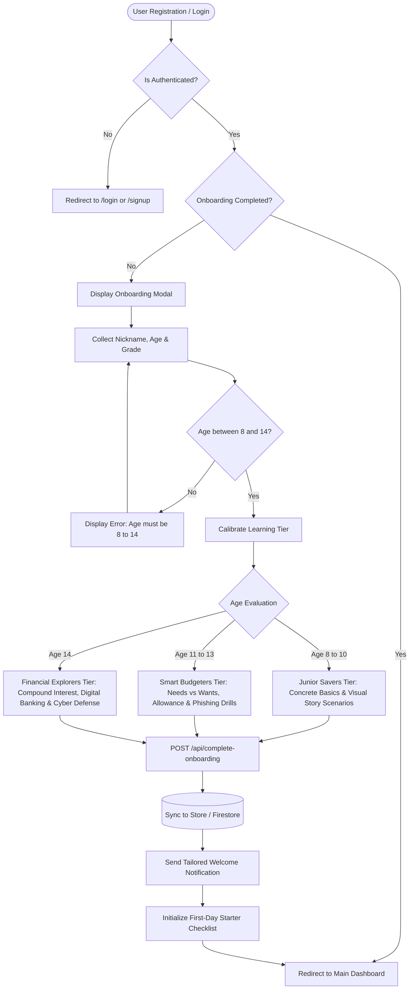
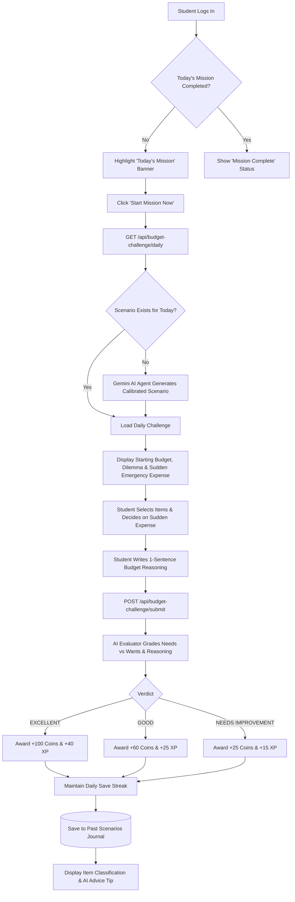
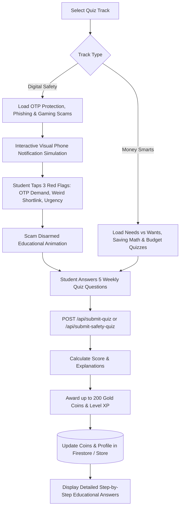
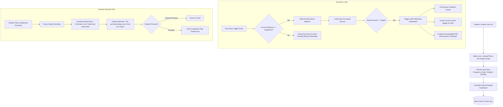
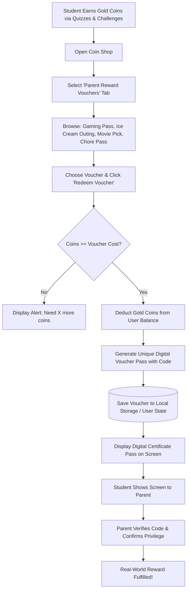

# AstraMinds — Process Flow Diagrams

This document outlines the core operational workflows and student journeys across the AstraMinds platform using Mermaid process diagrams.

---

## 1. Student Onboarding & Age-Tier Calibration Flow

This flow illustrates the user onboarding journey, age-gating (strictly ages 8–14), and adaptive curriculum calibration.

---

## 2. Daily Student Engagement Loop (AI Budget Mission)

The primary daily loop guiding students through real-world financial decision-making and AI feedback.

---

## 3. Weekly Financial Literacy & Digital Safety Quiz Loop

The dual-track quiz system testing both money management and cybersecurity awareness.

---

## 4. Savings Goal, Auto-Save & Delay Impact Flow

Illustrates how goal jars operate, how automated allowances fund them, and how impulse purchases trigger the delay impact calculator.

---

## 5. Parent-Approved Reward Voucher Redemption Flow

How virtual learning currency bridges to real-world privileges verified by parents.

