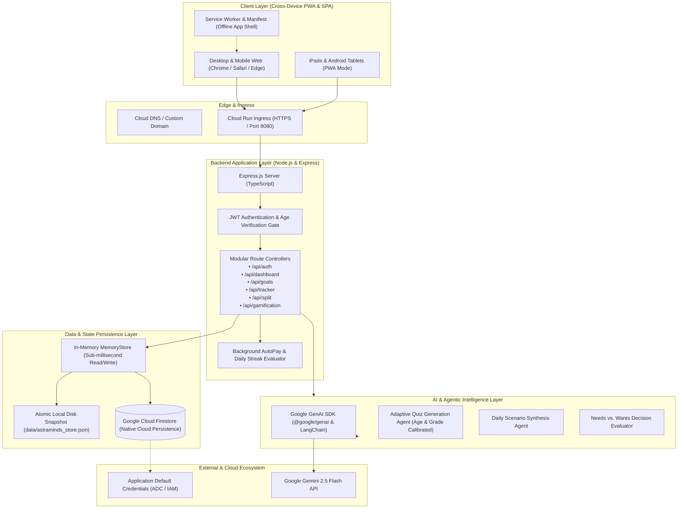
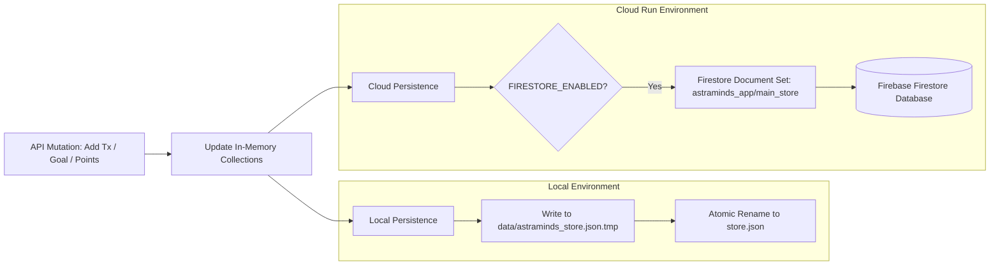

# AstraMinds — System Architecture

This document provides a comprehensive technical breakdown of the AstraMinds system architecture, component boundaries, data persistence strategy, AI pipelines, and deployment topology.

---

## 1. High-Level Architecture Diagram

---

## 2. Layer-by-Layer Architectural Breakdown

### 2.1 Client Layer (Frontend SPA & PWA)
* **Framework:** React 18.3 with TypeScript, bundled using **Vite 6**.
* **PWA Capabilities:** Configured with `manifest.json` and a network-first Service Worker (`sw.js`). Enables one-click installation on iPads, Android tablets, Chromebooks, and phones without requiring native app-store downloads.
* **Component Design System:**
  * **Tailwind CSS:** Utility-first styling with dark/navy high-tech aesthetic (`#0F2744`, `#0BBFBF`, `#10B981`, `#FF6B9D`).
  * **Shadcn/UI & Base UI:** Accessible dialogs, calendars, accordions, and sheets.
  * **Framer Motion & GSAP:** Micro-interactions, jar fill animations, coin shop purchases, and confetti triggers.
  * **Recharts:** Interactive SVG charting (Income/Expense trends, Needs vs. Wants donut charts, Goal progress trajectory).
* **State Management:** React Context API (`DashboardLayout`) providing user session state, wallet balance, streak counters, notifications, and instant profile re-fetching.

### 2.2 Backend Application Layer (API Gateway & Services)
* **Runtime:** Node.js 20+ (ES Modules) running an Express.js TypeScript server.
* **Security & Auth:**
  * Stateless **JWT (JSON Web Tokens)** passed in `Authorization: Bearer <token>` headers or secure cookies.
  * Password hashing via **bcryptjs**.
  * Strict age-validation filters (blocking onboarding values `< 8` or `> 14`).
  * `requireAuth` middleware enforcing route-level user isolation.
* **API Endpoints:**
  * `/api/auth`: Login, registration, OTP simulation, token refresh, and onboarding completion.
  * `/api/dashboard`: Dashboard statistics, daily budget challenges, challenge submissions, and decision history.
  * `/api/goals`: Goal jar CRUD, Auto-Save execution triggers, delay calculations, and PDF export.
  * `/api/tracker`: Transaction logging, category budget caps, analytics rollups, and auto-allowance schedules.
  * `/api/weekly-quiz` & `/api/safety-quiz`: Weekly dual-track quiz retrieval and grading.
  * `/api/gamification`: Daily spin wheel rewards, avatar shop purchases, and leaderboard rankings.

---

### 2.3 AI & Agentic Intelligence Layer
AstraMinds leverages the **Google Gemini Interactions API** (via `@google/genai` and `@langchain/google-genai`):

1. **Adaptive Quiz Generation Agent (`server/agents/quizAgent.ts`):**
   * Calibrates question vocabulary, scenario complexity, and distractor plausibility based on student age and grade.
   * Junior tier (ages 8–10) focuses on visual, concrete scenarios; middle/senior tiers (ages 11–14) focus on digital banking, OTP hygiene, and compound trade-offs.
2. **Daily Scenario Synthesis Agent (`server/agents/budgetAgent.ts`):**
   * Generates unique daily dilemma scenarios with realistic price points (in INR `₹`) and a surprise sudden emergency expense.
3. **Needs vs. Wants Evaluator:**
   * Reads student item selections, included emergency expenses, and written reasoning to assign verdicts (`EXCELLENT`, `GOOD`, `NEEDS_IMPROVEMENT`) and contextual advice.

---

### 2.4 Data Persistence & Storage Architecture (Hybrid Model)
To support both **offline local development** and **production containerized deployment on Google Cloud Run**, AstraMinds utilizes a dual-persistence abstraction:

* **In-Memory Store (`MemoryStore`):** Serves all reads and writes in sub-millisecond time. No request waits on external database locks.
* **Local Disk Snapshot:** Debounced snapshot written to `.tmp` and swapped via `fs.renameSync` (atomic operation). Guarantees local developers never lose pocket money or goal details upon server restart.
* **Google Cloud Firestore:** When `FIRESTORE_ENABLED=true` (or running inside Cloud Run with `K_SERVICE`), state is asynchronously synced to Google Cloud Firestore using **Application Default Credentials (ADC)**. When Cloud Run containers recycle or cold-start, state is restored instantly.

---

## 3. DevOps, Containerization & Cloud Deployment

### 3.1 Multi-Stage Docker Build
The production container is defined in [`Dockerfile`](file:///c:/Workspace/astraminds_mvp/Dockerfile):
* **Stage 1 (Builder):** `node:20-alpine` installs full dependencies, compiles TypeScript server (`tsconfig.server.json`), and builds Vite client assets into `dist/`.
* **Stage 2 (Runner):** Lightweight `node:20-alpine` installs production-only dependencies (`npm ci --omit=dev`), copies built artifacts (`dist/` and `dist-server/`), and runs `node dist-server/server.js`.
* Container dynamically binds to `$PORT` (default `8080`) supplied by Google Cloud Run.

### 3.2 Continuous Deployment (CI/CD)
* **Cloud Build (`cloudbuild.yaml`):** Integrates natively with Google Cloud Console. Push to GitHub triggers automated container builds in Google Container Registry and atomic deployments to Cloud Run with zero downtime.
* **GitHub Actions (`.github/workflows/deploy-cloudrun.yml`):** Alternative automated deployment pipeline using Google Cloud Workload Identity Federation or Service Account Keys.

---

## 4. Privacy, Security & Kid-Safety Sandbox Model

1. **100% Virtual Financial Sandbox:**
   * No real bank accounts, debit cards, UPI credentials, or real money transfers are ever requested or stored.
   * Students practice budgeting, auto-savings, and shopping using safe virtual currency.
2. **Zero Commercial Ads:**
   * The platform contains no advertising SDKs, tracking pixels, or third-party data broker scripts.
3. **Data Minimization:**
   * Accounts require only a first name or preferred nickname and email. No government identification numbers or sensitive financial records are collected.
4. **Isolated Tenant Context:**
   * All API routes strictly filter data queries by `req.userId` extracted from verified JWT tokens, preventing cross-tenant data leaks.
