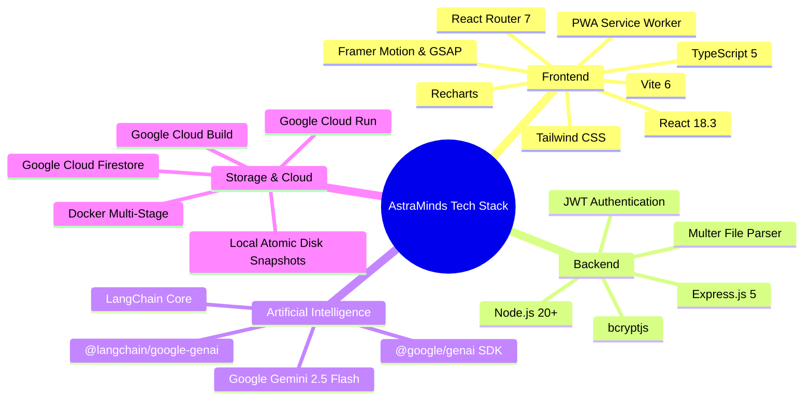

# AstraMinds — Technologies Used

This document provides a comprehensive inventory of all technologies, libraries, frameworks, cloud services, and development tools employed across the AstraMinds platform, along with the architectural justification for each.

---

## 1. Technology Stack Summary

---

## 2. Frontend Architecture & Client Technologies

| Technology | Version | Purpose & Architectural Rationale |
| :--- | :---: | :--- |
| **React** | `^18.3.1` | Core client framework utilizing concurrent rendering, functional components, hooks, and Context API for global state. |
| **TypeScript** | `^5.7.0` | End-to-end static typing across both client and server codebases, preventing runtime null-pointer and contract mismatches. |
| **Vite** | `^6.4.6` | Next-generation frontend build tool providing sub-second HMR (Hot Module Replacement) and optimized production Rollup bundling. |
| **React Router** | `^7.13.1` | Client-side routing for seamless single-page application navigation between landing page, auth flows, and student dashboard pages. |
| **Tailwind CSS** | `^4.0.0` | Utility-first CSS framework enabling high-performance styling without CSS bloat. Customized with dark-navy futuristic color palettes (`#0F2744`, `#0BBFBF`, `#10B981`, `#FF6B9D`). |
| **Framer Motion** | `^14.7.1` | Declarative motion library powering layout transitions, modal popovers, confetti triggers, and animated goal jar filling. |
| **GSAP (GreenSock)** | `^3.15.0` | High-performance animation engine used for complex landing page scroll reveals and text stagger carousels. |
| **Recharts** | `^3.8.1` | Composable SVG charting library rendering interactive spending trends, monthly budget utilization bars, and Needs vs. Wants donut charts. |
| **Lucide React** | `^0.475.0` | Consistent, lightweight SVG iconography tailored for dashboard metrics, trust badges, and security indicators. |
| **Base UI / Radix UI** | `^1.8.0` | Unstyled accessible primitives (calendars, dialogs, tooltips, accordions) ensuring full keyboard accessibility and screen-reader compliance. |
| **PWA Web App Manifest & Service Worker** | Standard | Enables home-screen installation on iPads, Chromebooks, and Android tablets, offline asset caching, and standalone window execution. |

---

## 3. Backend, Server & API Technologies

| Technology | Version | Purpose & Architectural Rationale |
| :--- | :---: | :--- |
| **Node.js** | `>=20.x` | Modern server JavaScript runtime running native ES modules (`"type": "module"`). |
| **Express.js** | `^5.3.0` | Fast, minimalist web framework handling RESTful JSON APIs, authentication routes, and static asset serving in production. |
| **jsonwebtoken (JWT)** | `^9.0.3` | Cryptographically signed tokens (`HS256`) facilitating stateless user authentication across API requests with zero session database bottlenecks. |
| **bcryptjs** | `^3.0.3` | Salted password hashing algorithm safeguarding student and parent account credentials against rainbow-table attacks. |
| **CORS** | `^2.8.6` | Middleware configuring Cross-Origin Resource Sharing policies for authorized domain origins in development and production. |
| **Multer** | `^2.5.0` | Streaming `multipart/form-data` parser handling bill uploads, receipt attachment scans, and custom goal photo uploads. |
| **jsPDF & jsPDF-AutoTable** | `^4.2.1` | Client/server PDF generation engine outputting printable student financial summary reports and **Goal Crusher Achievement Certificates**. |

---

## 4. Artificial Intelligence & Agentic Engine

| Technology | Version | Purpose & Architectural Rationale |
| :--- | :---: | :--- |
| **Google Gemini 2.5 Flash** | Latest API | High-speed, cost-effective multimodal LLM generating daily budget scenarios, calibrating quiz difficulties, and evaluating student reasoning. |
| **`@google/genai`** | `^3.6.1` | Official Google GenAI SDK providing direct, low-latency access to Gemini models with structured JSON schema outputs. |
| **LangChain Core** | `^1.4.2` | Orchestration primitives for managing prompt templates, output parsers, and multi-step agent reasoning chains. |
| **`@langchain/google-genai`** | `^2.3.6` | LangChain integration layer connecting Gemini models to agentic workflows. |
| **`@langchain/langgraph`** | `^1.7.5` | State graph framework enabling cyclical multi-turn conversational agents (used for AstraBot interactive coaching). |

---

## 5. Storage, Persistence & Cloud Infrastructure

| Technology | Type | Purpose & Architectural Rationale |
| :--- | :---: | :--- |
| **Google Cloud Firestore** | NoSQL Database | Highly scalable, serverless document store persisting user profiles, streaks, transactions, and badges across Cloud Run scaling events. |
| **`@google-cloud/firestore`** | Client Library | Official Node.js Firestore SDK utilizing Google Cloud **Application Default Credentials (ADC)** for zero-secret cloud deployments. |
| **Local Atomic Snapshots** | File Persistence | Local JSON backup mechanism writing to `.tmp` files and swapping atomically (`fs.renameSync`) for 100% offline development reliability. |
| **Google Cloud Run** | Serverless Containers | Fully managed compute platform automatically scaling containers from zero to handle school classroom surges while minimizing idle costs. |
| **Google Cloud Build** | CI/CD Automation | Google Cloud native continuous integration pipeline building multi-stage Docker images on every push to the `main` GitHub branch. |
| **Google Artifact Registry** | Container Registry | Secure, private container registry storing tagged Docker images deployed to Cloud Run. |
| **Docker** | Containerization | Multi-stage build (`Dockerfile`) compiling TypeScript server and Vite client into an ultra-lean 150MB production image based on Alpine Linux. |

---

## 6. Developer Experience, Testing & Tooling

| Tool | Purpose |
| :--- | :--- |
| **`tsx`** | High-performance TypeScript execution tool for instant local development server reloads (`tsx watch server.ts`). |
| **ESLint** | Static code analysis enforcing clean code patterns and accessibility standards across the React application. |
| **Cross-Env** | Cross-platform environment variable setting ensuring scripts execute identically across Windows PowerShell, macOS, and Linux. |
| **PostCSS & Autoprefixer** | CSS post-processing pipeline ensuring cross-browser prefix compatibility across WebKit, Blink, and Gecko engines. |
